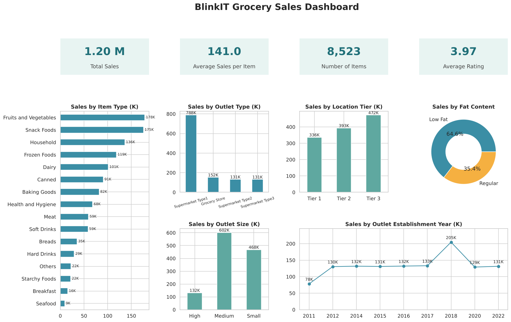

# BlinkIT Grocery Sales Analysis

**Student:** Dinesh Bhargav | **Tool used:** Python (Pandas, NumPy, Matplotlib, Seaborn) in Jupyter Notebook

## 1. Project overview
BlinkIT sells grocery and daily-use products through 10 outlets of different types, sizes and city tiers. Management wants to know which products, categories, outlets and locations drive sales and where performance can be improved. This analysis is written for BlinkIT's management team, including non-technical readers.

## 2. Dataset
- File: `data/BlinkIT Grocery Data.xlsx` (original, unedited)
- 8,523 rows and 12 columns. Each row is one product listed at one outlet.
- 1,559 unique products, 16 item types and 10 outlets opened between 2011 and 2022. The data has no order dates, so there is no time trend; the outlet establishment year is used instead.
- The brief asked for four things, which match the notebook sections: understanding the business, making the data reliable, finding what drives sales, and recommendations for management.

## 3. Data preparation
- **Checks done:**
  - Missing values: Item Weight was empty for 1,463 rows (17%). Each item always has the same weight, so I filled the gaps from the same item in other outlets, then from the item-type median.
  - Duplicates: 0 duplicate rows and 0 repeated item-outlet pairs.
  - Unusual values: 526 rows had Item Visibility = 0, which is impossible for a product on sale. I replaced them with that item's average visibility. Low ratings (1–2) are real feedback, so I kept them.
  - Data types: all numeric columns were read correctly.
- **Inconsistent labels fixed:**
  - Item Fat Content had 5 spellings (`Low Fat`, `low fat`, `LF`, `Regular`, `reg`). I merged them into 2.
  - Outlets OUT010, OUT017 and OUT045 were recorded with three different sizes each. I set each outlet to its most frequent size.
- **Fields I created:**
  - `Outlet Age` = 2026 − Outlet Establishment Year
  - `Item Category` = Food / Drinks / Non-Consumable, taken from the first two letters of the Item Identifier (FD / DR / NC)
- **Cleaned dataset:** saved separately as `data/blinkit_cleaned.csv`. The original file is never changed.
- **Cancelled and returned orders:** this dataset has no order-status field, so it does not apply.

## 4. KPI definitions
- **Total Sales** = sum of `Sales` over all rows → 1,201,681
- **Average Sales per Item** = Total Sales ÷ number of rows → 140.99
- **Number of Items** = count of rows (item listings) → 8,523
- **Average Rating** = mean of `Rating` → 3.97
- **Sales Share %** = sales of a group ÷ Total Sales × 100
- **Sales per Outlet** = sales of an outlet type or tier ÷ number of distinct outlets in it

All KPIs are calculated in the notebook from the data, not typed in. Each one can be checked against a simple sum or count of the source column.

## 5. Dashboard preview


A PDF version is in `screenshots/dashboard.pdf`. The individual analysis charts are in `screenshots/charts/`.

## 6. Key findings
1. **Two categories lead sales.** Fruits & Vegetables (14.8%) and Snack Foods (14.6%) bring in the most sales. This is mainly because they have the most listings: average sales per listing is similar across all 16 item types (126–149).
2. **Supermarket Type1 outlets bring in 65.5% of all sales** (787.5K of 1.20M), because there are six of them. Every supermarket sells about 131K, whatever its type.
3. **Grocery stores sell 42% less than supermarkets.** Each sells about 76K, compared with about 131K for a supermarket. They stock about 540 products against about 930, while sales per listing are the same (about 140). The gap comes from product range, not from customers spending less.
4. **Visibility, weight and rating do not drive sales.** Their correlation with sales is close to zero. Top-25% products are stocked in about 6.6 outlets on average, against about 4.7 for bottom-25% products. Availability matters more than shelf position.
5. **Sales are concentrated.** 60% of products (931 of 1,559) generate 80% of sales. Tier 2 cities have the highest sales per outlet (131K), because all three of their outlets are supermarkets.

## 7. Recommendations
1. **Widen the product range in the two grocery stores (OUT010, OUT019).** Add the top-selling item types first: Fruits & Vegetables, Snack Foods, Household and Dairy. Their sales per listing already match supermarkets (finding 3), so a wider range should close much of the 42% gap.
2. **Stock good products in more outlets before dropping them.** Spend promotion money on availability instead of visibility. Bottom-quartile products are carried by fewer outlets, and visibility shows no link to sales (finding 4).
3. **Keep the 931 products that make 80% of sales always in stock, and prefer the supermarket format for new outlets.** Supermarkets sell about 131K each in every city tier (findings 2 and 5).

## 8. How to use the analysis
- Open `notebook/Blinkit_Sales_Analysis.ipynb` on GitHub to read it with all outputs and charts. No setup is needed.
- To re-run it, install the packages with `pip install -r requirements.txt` and open the notebook in Jupyter from the `notebook/` folder. It reads `../data/BlinkIT Grocery Data.xlsx` and rewrites the cleaned data and the dashboard images.
- The notebook follows the brief's four objectives in order: Objective 2 (data cleaning) runs first, then Objectives 1, 3 and 4. A summary dashboard is at the end.
- The dashboard is a static image, so it has no slicers. Each breakdown (item type, outlet type, size, tier, fat content) is shown as its own chart.

## 9. Limitations
- There are no order dates, so monthly or seasonal trends can't be measured.
- There is no cost or profit data, so the analysis covers sales only, not margins.
- There is no customer-level data, so repeat purchases and customer segments are not covered.
- The `Sales` column has no stated currency unit. Values are shown as given.
- Three outlets had conflicting sizes. I used each outlet's most frequent size, which may not be its true size.

## Repository structure
```
├── README.md
├── data/
│   ├── BlinkIT Grocery Data.xlsx    # original dataset (unedited)
│   └── blinkit_cleaned.csv          # cleaned dataset produced by the notebook
├── notebook/
│   └── Blinkit_Sales_Analysis.ipynb # full analysis with outputs
├── screenshots/
│   ├── dashboard.png                # one-page summary dashboard
│   ├── dashboard.pdf
│   └── charts/                      # individual analysis charts
└── requirements.txt
```
