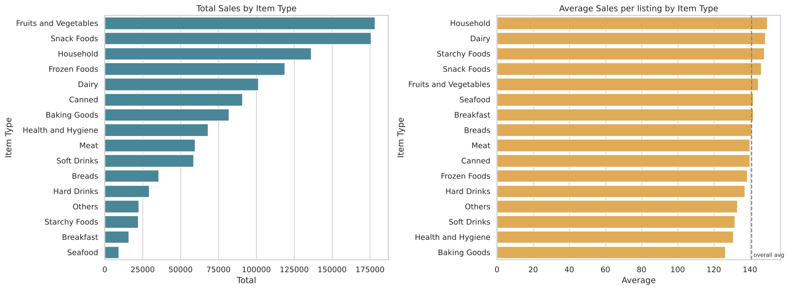
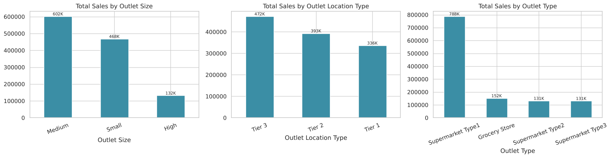

# BlinkIT Grocery Sales Analysis

Python data-analytics project analysing BlinkIT grocery sales across products, categories, outlets and locations. Done as Project 2 of the AI/ML internship at Sapphire IQ.

**Tools:** Python · Pandas · NumPy · Matplotlib · Seaborn · Jupyter Notebook

## Dataset
`data/BlinkIT Grocery Data.xlsx`: 8,523 item-outlet records, 1,559 products, 16 product types, 10 outlets.
Columns: item fat content, identifier, type, weight, visibility, outlet ID, type, size, location tier, establishment year, sales and rating.

## What the notebook covers
| Objective | Tasks |
|---|---|
| 1. Understand the business | Product mix, outlet types and locations, overall sales KPIs, ratings |
| 2. Make the data reliable | Missing weights filled, 526 zero-visibility values fixed, fat-content labels standardised, conflicting outlet sizes corrected, duplicate and outlier checks |
| 3. Find what drives sales | Sales by product type and outlet type, correlation of visibility, weight and rating with sales, top vs bottom performers |
| 4. Support decisions | Top products, Pareto analysis, best and worst outlets and locations, recommendations |

## Key findings
- **Total sales ≈ 1.20M**, average ≈ 141 per item listing, average rating 3.97 (76% of listings rated 4+).
- **Fruits & Vegetables** and **Snack Foods** lead total sales (~15% each).
- **Supermarket Type1** brings in ~65% of sales because there are six of them. Every supermarket sells ~130K, while the two **Grocery Stores sell ~76K**. That is ~58% of a supermarket, because they stock ~40% fewer products.
- Item visibility, weight, rating and outlet age show **no meaningful correlation** with sales. The main driver is **product range and availability**: top-quartile products are stocked in ~6.6 outlets vs ~4.7 for bottom-quartile products.
- 60% of products generate 80% of sales.




## Recommendations
1. Widen the product range in Grocery Stores.
2. Stock well-rated, under-distributed products in more outlets.
3. Add more SKUs in categories that sell well per listing (Starchy Foods, Household, Dairy).
4. Keep the top 60% of products (80% of sales) always in stock and review the slow tail.
5. Prefer the supermarket format for new outlets.
6. Make item weight, visibility and outlet size mandatory and validated at data entry.

## How to run
```bash
pip install -r requirements.txt
jupyter notebook Blinkit_Sales_Analysis.ipynb
```
The notebook also writes the cleaned dataset to `data/blinkit_cleaned.csv`.

## Project structure
```
├── Blinkit_Sales_Analysis.ipynb   # full analysis with outputs
├── data/
│   ├── BlinkIT Grocery Data.xlsx  # raw data
│   └── blinkit_cleaned.csv        # cleaned data
├── images/                        # exported charts
├── requirements.txt
└── README.md
```
